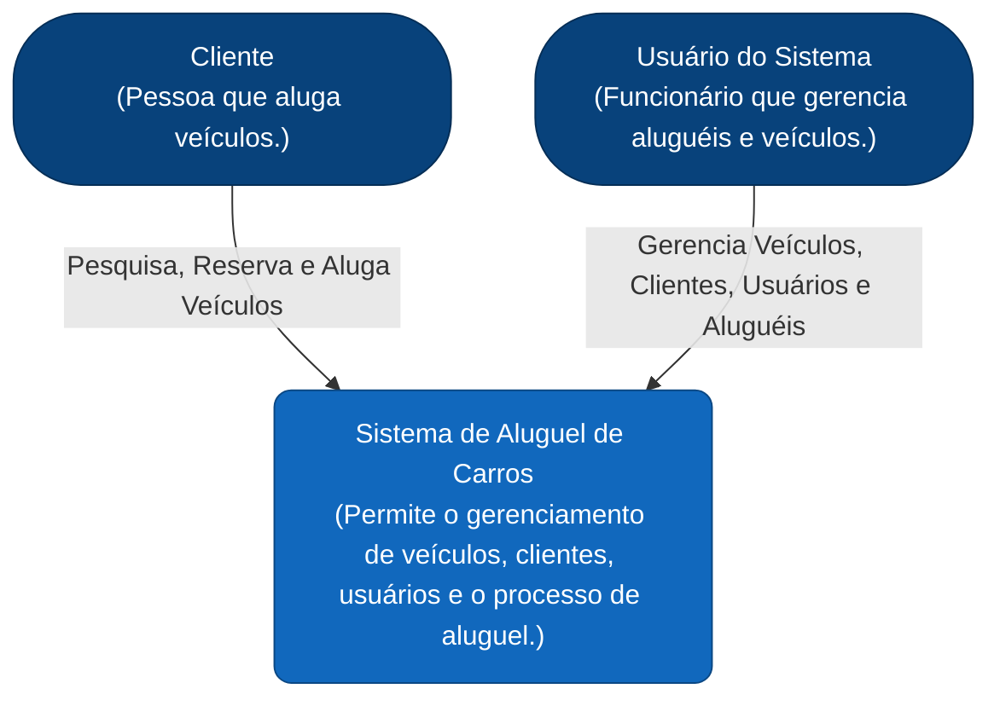
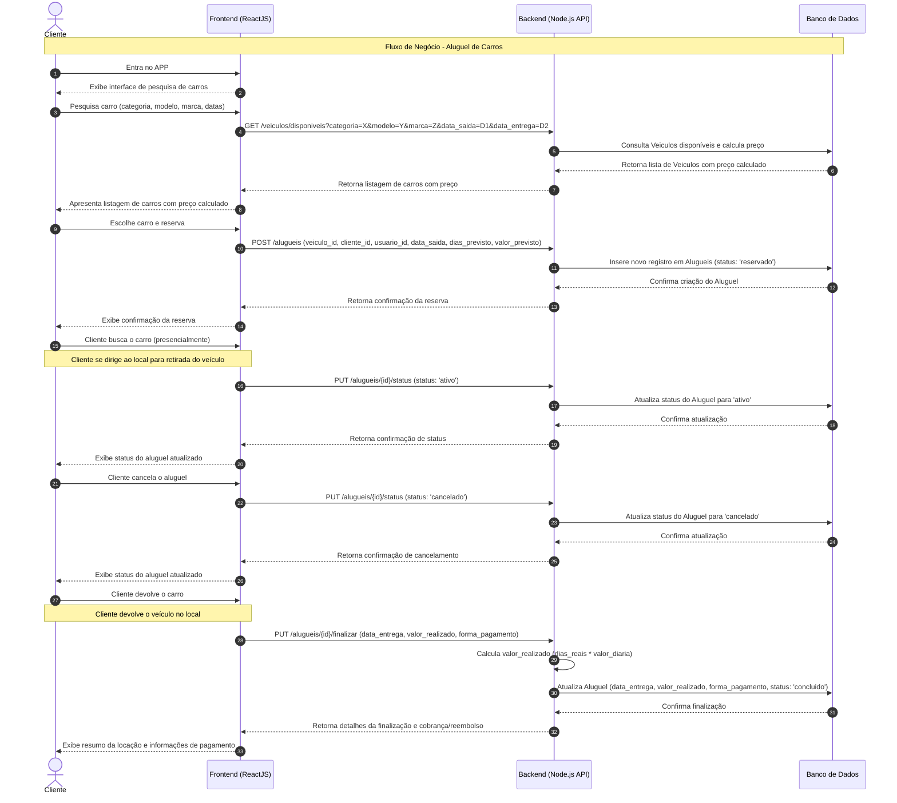

## 1. Missão deste documento

Este arquivo é o **ponto de entrada único** para agente de IA que trabalhe no projeto **Aluguel de Carros**. Ele define hierarquia de verdade, contexto mínimo obrigatório por fase, restrições de arquitetura e critérios de aceite para geração de artefatos.

**Regra de ouro:** em qualquer conflito entre artefatos, a precedência é:

```
especificacao.md > openapi.yaml > schema.json > código gerado
```

---

## 2. O que é o Projeto

Portal de Gerenciamento e Auto Atendimento no aluguel de véiculos.

- **Linguagem:** NodeJS (backend)
- **Framework HTTP:** Express.js
- **Padrão de erro da API:** `{ code, type, message, detailedMessage }`
- **Padrão de lista da API:** `{ hasNext, items }` — pageSize+1 trick
- **Banco:** PostgreSQL — schemas `iam`, `aluguel`
- **Autenticação:** API Key (portal do cliente) + JWT/Bearer (portal usuario)

---

## 3. Fontes de verdade e onde estão

| Artefato               | Caminho                  | Usa para                                                     |
| ---------------------- | ------------------------ | ------------------------------------------------------------ |
| Especificação técnica  | `specs/especificacao.md` | ADRs, COMPs, C4, regras de negócio, testes    |
| Schema físico do banco | `specs/schema.json`      | Migrations, modelos, repositórios, índices, FKs           |
| Contrato HTTP          | `specs/openapi.yaml`     | Handlers, DTOs, validações, status codes, testes de contrato |

---

## 4. Arquitetura obrigatória

Fluxo de Negocio
- Cliente Entra no APP
  - Pesquisa um carro (categoria, modelo, marca)
  - Informa as datas de previsão (dias_previsto)
  - Apresenta listagem de todos os carros da categoria|modelo|marca com o preço calculado
- Cliente escolhe o carro e reseva o carro.
  - Sistema cria um registro de Aluguel com as data de saida e o dias previstos + valor previsto.
- Cliente busca o carro e o usuario do sistema atualiza o status da reverva no Aluguel.
- Cliente cancelou o aluguel, e o usuario do sistema precisa alterar o status para cancelado
- Cliente devolveu o carro, o usuario finaliza a locação e calcula o valor_realizado e gera cobrança ou reembolso.

---

## 5. Contrato HTTP — resumo de endpoints

A tabela abaixo sumariza o mecanismo de autenticação e as permissões exigidas por endpoint, conforme declarado em `specs/openapi.yaml`. Se um endpoint não listar uma permissão explícita no `openapi.yaml`, apenas o esquema de segurança é indicado.

**Formato de erro unificado** (todos os endpoints):
```json
{
  "code": "VALIDATION_ERROR",
  "type": "error",
  "message": "...",
  "detailedMessage": "..."
}
```

Observações sobre a documentação OpenAPI:

- Validações: Incluí algumas validações básicas como minLength, maxLength, minimum, maximum, pattern (para placa e telefone) e enum (para status e forma de pagamento). Em um projeto real, você pode usar bibliotecas como Joi ou Yup no Node.js para implementar essas validações no backend.
- Rotas de Status e Finalização: Criei rotas específicas (/alugueis/{id}/status e /alugueis/{id}/finalizar) para gerenciar as transições de estado do aluguel, o que é uma boa prática para APIs RESTful.
usuario_id: É importante que o usuario_id seja enviado nas requisições de atualização de status e finalização para registrar qual funcionário realizou a ação.
- readOnly: Campos como id, created_at, updated_at e data_reserva são marcados como readOnly pois são gerados pelo sistema.
- VeiculoInput vs Veiculo: Separado o schema de entrada (VeiculoInput) do schema de saída (Veiculo) para deixar claro quais campos são esperados na criação/atualização e quais são retornados pela API.

---

## 6. Modelo de dados

Estrutura de dados em DBML para o sistema de aluguel de carros:

```dbml
Project "Sistema de Aluguel de Carros" {
  database_type: 'PostgreSQL'
  Note: 'Modelagem de dados para o sistema de aluguel de carros.'
}

Table Veiculos {
  id int [pk, increment]
  marca varchar(255) [not null]
  modelo varchar(255) [not null]
  categoria varchar(255) [not null]
  ano_fabricacao int [not null]
  placa varchar(10) [unique, not null]
  valor_diaria decimal(10, 2) [not null]
  disponivel boolean [default: true]
  created_at timestamp [default: `now()`]
  updated_at timestamp [default: `now()`]

  Note: 'Armazena informações sobre os veículos disponíveis para aluguel.'
}

Table Usuarios {
  id int [pk, increment]
  username varchar(255) [unique, not null]
  password varchar(255) [not null]
  created_at timestamp [default: `now()`]
  updated_at timestamp [default: `now()`]

  Note: 'Armazena informações dos usuários do sistema (funcionários).'
}

Table Clientes {
  id int [pk, increment]
  cod varchar(50) [unique, not null]
  nome varchar(255) [not null]
  endereco varchar(255)
  telefone varchar(20)
  data_nascimento date
  created_at timestamp [default: `now()`]
  updated_at timestamp [default: `now()`]

  Note: 'Armazena informações dos clientes que alugam os veículos.'
}

Table Alugueis {
  id int [pk, increment]
  veiculo_id int [not null]
  cliente_id int [not null]
  usuario_id int [not null] // Usuário que registrou/atualizou o aluguel
  data_saida date [not null]
  data_entrega date
  data_reserva date [not null, default: `now()`]
  dias_previsto int [not null]
  valor_previsto decimal(10, 2) [not null]
  valor_realizado decimal(10, 2)
  forma_pagamento varchar(50) [not null, default: 'dinheiro'] // dinheiro, pix, cartao
  status varchar(50) [not null, default: 'reservado'] // reservado, ativo, cancelado, concluido
  created_at timestamp [default: `now()`]
  updated_at timestamp [default: `now()`]

  Note: 'Registra os aluguéis de veículos.'
}

Ref: Alugueis.veiculo_id > Veiculos.id
Ref: Alugueis.cliente_id > Clientes.id
Ref: Alugueis.usuario_id > Usuarios.id
```

**Explicação da Modelagem:**

- Veiculos: Contém os detalhes de cada carro. Adicionado valor_diaria para calcular o preço do aluguel e disponivel para controlar a disponibilidade.
- Usuarios: Para os funcionários que interagem com o sistema.
- Clientes: Informações dos clientes.
- Alugueis: Tabela central que liga veículos, clientes e usuários. Inclui campos para datas, valores (previsto e realizado), forma de pagamento e o status do aluguel, que é crucial para o fluxo de negócio.

---

## 7. Banco de dados PostgreSQL

### 7.1 Extensões obrigatórias

```sql
-- Executar uma vez no init.sql (antes de qualquer migration)
CREATE EXTENSION IF NOT EXISTS "uuid-ossp";      -- uuid_generate_v4() como fallback
CREATE EXTENSION IF NOT EXISTS "pgcrypto";       -- gen_random_bytes(), crypt(), digest()
CREATE EXTENSION IF NOT EXISTS "btree_gin";      -- índices GIN em colunas escalares + JSONB
```

> **Nota:** UUIDv7 é gerado pela aplicação Go (`pkg/uuidv7`) — não pelo banco. `uuid-ossp` existe como fallback e para compatibilidade com seeds.

---

## 8. Arquitetura — C4 Model

Este diagrama detalha a interação entre o Cliente (Frontend), o Sistema de Aluguel (Backend) e o Banco de Dados para o fluxo de negócio de aluguel de carros.



---

## 9. Diagramas de Fluxo




